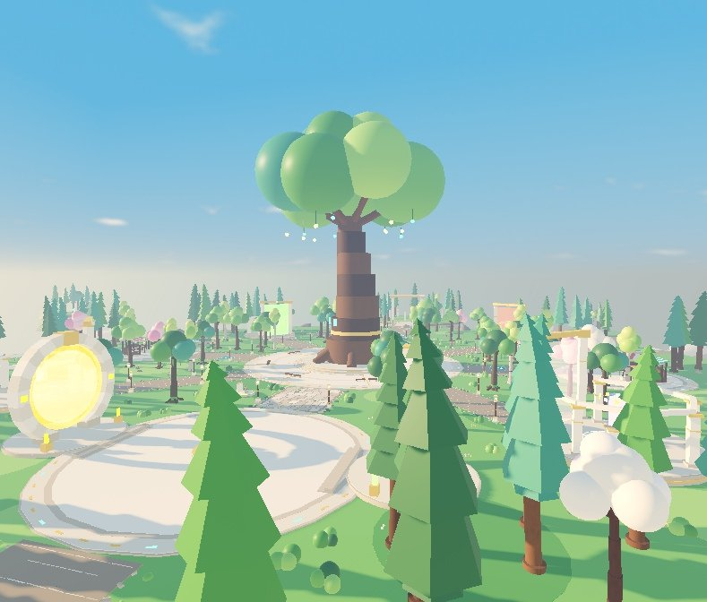
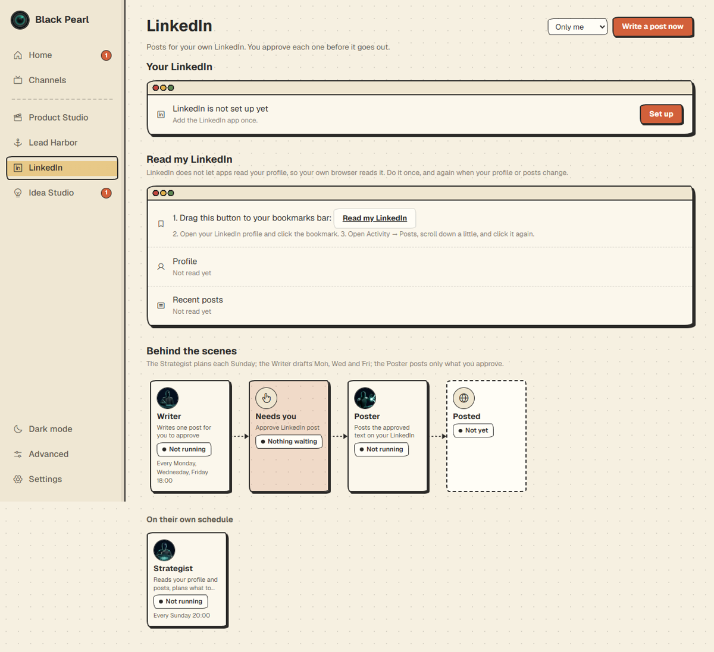
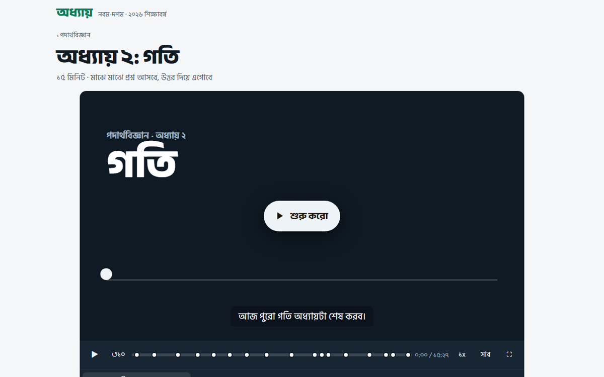
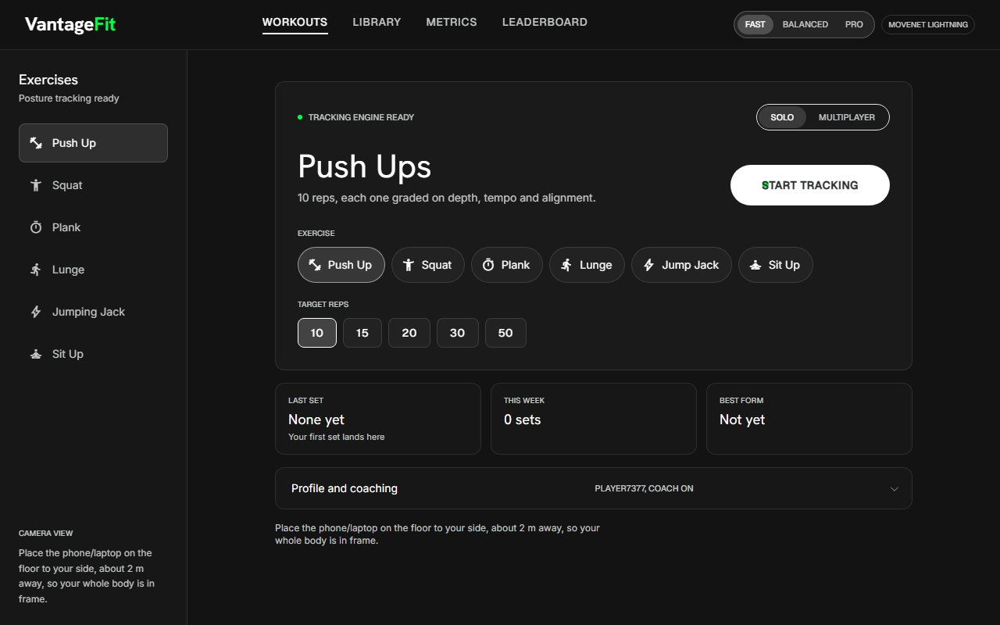
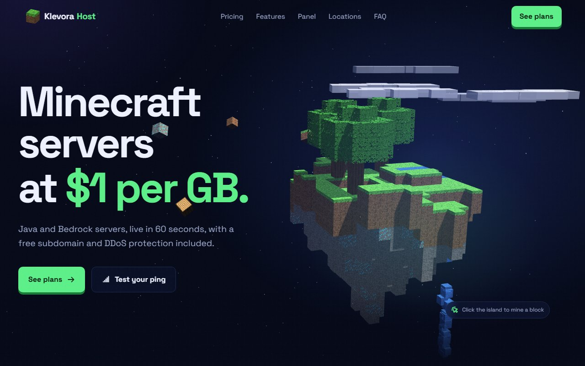
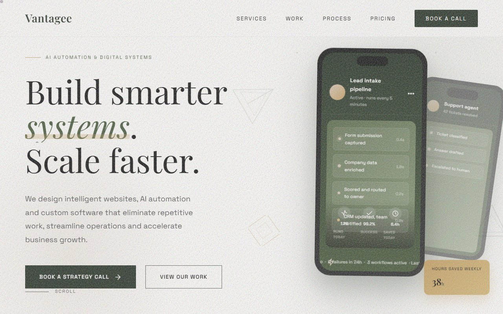

# Projects

A showcase of things I've built. Source code is private; this repo only describes the projects.

## Screenshots

| | |
|---|---|
|  **Guardian Shrine**: Roblox pet game hub |  **Black Pearl**: AI agent workflow board |
|  **অধ্যায় (Odhyay)**: narrated Bangla lesson player | |

## Apps and tools

| Project | What it does | Built with | State |
|---|---|---|---|
| **Lock-In** | Windows focus workspace that tiles real apps under a bar with a timer and music | Electron, Node | Built |
| **Holo Control** | Control two monitors with hand, eyes and voice, fully offline | Python, MediaPipe, Whisper, sherpa-onnx | Built |
| **Runo** | Private, local voice assistant over a personal notes vault | Python, Whisper, Piper, web UI | Built |
| **Nizam** | Daily 0–100 accountability score with streaks and a friends leaderboard | React Native, Expo, Supabase | Built |
| **GymApp** | Workout tracker with an AI coach, friends and progression | Flutter, Supabase, LLM APIs | Built |
| **অধ্যায় (Odhyay)** | Animated, narrated class 9–10 lessons with recall quizzes (Bangla) | Vanilla JS, neural TTS | Prototype |

## Websites

| | |
|---|---|
|  **VantageFit AI Form Tracker**: the camera counts reps and grades form live in the browser (MoveNet / BlazePose, One Euro smoothing, Supabase) |  **Klevora Host**: Minecraft server hosting landing page with an interactive 3D island |
|  **Vantagee**: AI automation and digital systems agency site | |

### Client demo sites

Pitch demos built for real businesses. Names and screenshots are left out.

| Demo | What it is | Built with |
|---|---|---|
| **Real-estate photography site redesign** | 5-page redesign of a property photography studio's website | HTML/CSS/JS |
| **Coaching brand site redesign** | 3-page redesign for a coaching business | HTML/CSS/JS |
| **Gaming lounge, gym and restaurant site** | Multi-venue site with a booking flow and an admin panel | React, Vite, TypeScript, shadcn |
| **Golf venue site** | Site, booking and admin panel demo for a golf venue | Web app |

## AI agents

| Project | What it does | Built with | State |
|---|---|---|---|
| **AI agent team** | 24/7 agent "employees" that report over Slack and share long-term memory | Agent framework, Python, Slack | Live |
| **Idea Studio** | Slack pipeline that researches, debates and scores new business ideas | Multi-agent, Claude | Live |
| **Black Pearl** | Hub that shows agent "ships" working on a live workflow board | Node | Built |
| **My Cute Panda** | Slack companion bot that chats in Banglish | Python, Slack Bolt, Groq, SQLite | Live |

## Games

| Project | What it is | Built with | State |
|---|---|---|---|
| **Guardian Shrine** | Roblox pet game: hatch, evolve and protect guardians across worlds | Roblox Luau | Built |
| **The Trust** (working title) | Action RPG set in 7th-century Arabia | Godot 4, GDScript | Playable slice |
| **Nightjar** | Top-down stealth game | TypeScript, Phaser 3 | Built |
| **TriplePlay** | Card battler, racing and tower defense in one hub | TypeScript, Phaser 3 | Built |
| **কুয়াশা (Kuasha)** | Roguelite deckbuilder | TypeScript, Vite | Built |
| **ভাঙন (Bhangon)** | Board game against a river that eats the squares | TypeScript, Vite | Built |
| **Glimmo** | Rope-cutting physics puzzle | TypeScript, Vite | Built |
| **সেচ (Sech)** | Irrigation routing puzzle | TypeScript, Vite | Built |
| **Rickshaw Mama** | Endless runner through city streets | HTML5 | Built |
| **Ghuri Kata** | Kite-fighting duel | HTML5 | Built |
| **Cha Wala** | Idle tap-to-earn tea-stall tycoon | HTML5 | Built |
| **Cargo Wars** | Roblox team PvP cargo-convoy game | Roblox Luau | Prototype |

## Subscription-based apps

A family of subscription-based web apps on one shared login / OTP / subscription platform, with a revenue and uptime dashboard across all of them.

| Project | What it does | Built with |
|---|---|---|
| **খবর (Khobor)** | News feed that reads articles aloud, plus news radio | PHP |
| **দেনা-পাওনা (Dena-Paona)** | Tracks household money owed and due | PHP, JS |
| **দ্বীন সাথী (Deen Sathi)** | Daily Islamic companion PWA | HTML/JS |
| **মেধা (Medha)** | Quiz with a prize draw | PHP |
| **মাঠ, মগজ, চমক, বাহিনী** | Sports, puzzle, mixed and action arcades | PHP, JS |
| **খেলাঘর (Khelaghor)** | Game portal | HTML/JS |
| **হালখাতা (Halkatha)** | Ledger app for shopkeepers | Flutter |
| **সমিতি (Shomiti)** | Savings committee (ROSCA) tracker | HTML/JS |
| **Shared platform + dashboard** | Login, OTP, subscribers; revenue and uptime across apps | PHP, Node |

## Video and content

| Project | What it is | Built with |
|---|---|---|
| **Ad Factory** | AI pipeline that makes vertical UGC-style video ads end to end: script, voices, shots, edit, captions | AI image/video/voice tools, Remotion |
| **Panda Legion Shorts** | Animated history Shorts series (3 episodes) | Blender |
| **Faceless YouTube pipeline** | Long-form explainer videos plus an upload and analytics agent | Python, Remotion, agents |

## Contact

Want a demo? Open an issue or reach me through my GitHub profile.
